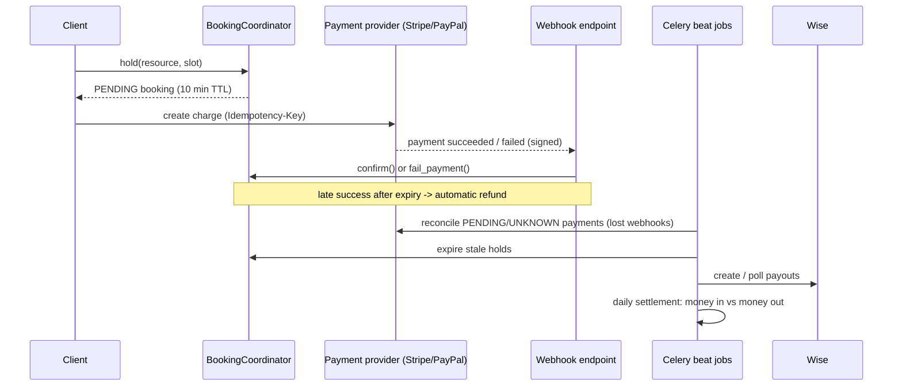

# Interview notes

A walkthrough of the design decisions in DeskFlow, organised as the questions an interviewer is
likely to ask. Each section gives a short answer, the reasoning behind it, and where to look in the
code. ADRs in [`docs/adr`](adr) hold the longer form.

## The system in one picture

Scale target from the brief: ~50K transactions/month, which is ~1.7K/day and well under one
transaction per second on average. The design is driven by **correctness under concurrency and
unreliable providers**, not by raw throughput.

---

## 1. Bookings and concurrency

**Q: How do you prevent double-booking?**

Two layers, with different jobs:

1. **Redis lock per resource** (`bookings/locks.py`) — `SET key token NX PX ttl`, released by a Lua
   script that deletes only if the token still matches. It is acquired *outside* the DB
   transaction and released *after* commit. Its purpose is UX and load-shedding: the second
   request fails fast with `SlotUnavailable` instead of queueing on row locks.
2. **PostgreSQL exclusion constraint** (`bookings/models.py`, `booking_no_overlap_active`) — a
   GiST constraint over `(resource, TSTZRANGE(start, end, '[)'))` with `&&`, applied only to
   `PENDING` and `CONFIRMED` rows. This is the **source of truth**. An `IntegrityError` from it is
   translated into the same `SlotUnavailable`.

**Q: Why not just the lock? Why not just the constraint?**

- Locks alone are not a correctness guarantee: TTL expiry during a GC pause, Redis failover, or a
  code path that forgets to lock all break it. The database is the only place where the invariant
  can be enforced atomically.
- The constraint alone is correct, but under contention every loser does a full insert and
  rollback. The lock turns that into a cheap early rejection.

**Q: Why a half-open range `[start, end)`?**

So back-to-back bookings (10:00–11:00 and 11:00–12:00) do not overlap. With a closed range they
would collide at 11:00.

**Q: Why does the constraint only apply to some statuses?**

Expired, failed and cancelled bookings must free the slot without deleting history. A partial
exclusion constraint (`condition=Q(status__in=[...])`) keeps the audit trail and the invariant.

## 2. The booking state machine

**Q: How do you keep booking status consistent?**

`BookingCoordinator` (`bookings/services.py`) is the only code that changes `Booking.status`.
Every transition:

- runs in `transaction.atomic()`,
- locks the row with `select_for_update()`,
- checks the current status against an explicit allowed set before writing.

States: `PENDING → CONFIRMED | EXPIRED | PAYMENT_FAILED | CANCELLED`, plus
`REFUNDED_LATE_WEBHOOK` for payments that arrive after the hold is gone.

**Q: What happens if the payment succeeds at minute 10:01?**

`confirm()` re-checks `expires_at` under the row lock. If the hold has expired it commits
`EXPIRED` and raises `HoldExpired`; the payment layer then refunds (see §5). We never confirm a
booking whose slot may already belong to someone else.

**Q: How do stale holds get released?**

`expire_stale()` is a single conditional `UPDATE ... WHERE status = PENDING AND expires_at < now`.
Because the condition is evaluated by Postgres per row, it is safe to run concurrently with
`confirm()` — whichever commits first wins, the other sees a row that no longer matches.

## 3. Payment provider abstraction

**Q: How do you support Stripe, PayPal and Wise behind one interface?**

`payments/providers/base.py` defines `BasePaymentProvider` with `create_charge`, `get_charge`,
`refund`, `parse_webhook` and a `status_map`. Providers register themselves in a registry
(`payments/providers/registry.py`) and the rest of the code asks for one by name.

Wise has a separate `BasePayoutProvider`: it sends money out and cannot take charges, so forcing
it into the charge interface would mean `NotImplementedError` methods — an interface lie.

**Q: How are provider differences hidden?**

| Concern | Stripe | PayPal | Wise |
| --- | --- | --- | --- |
| Auth | Secret key | OAuth2 client credentials, token cached with 60 s margin | API token |
| Idempotency | `Idempotency-Key` header | `PayPal-Request-Id` header | `customerTransactionId` |
| Amounts | Integer minor units | Decimal strings (zero-decimal currencies handled) | Decimal |
| Flow | Direct charge | Create order → buyer approves → capture | Quote → transfer → fund |
| Webhook verification | Local HMAC | Remote `verify-webhook-signature` API call | Polling (no webhook wired) |

Internally money is always an integer in minor units, so there is no float rounding anywhere.

**Q: How do you handle provider errors?**

`payments/providers/http.py` is the single place that decides retryability: timeouts, transport
errors, 408/409/425/429 and 5xx raise `ProviderError(retryable=True)`; everything else is
non-retryable. Retrying is safe *only because* every mutating call carries an idempotency key.

**Q: What if a provider returns a status you don't know?**

It maps to `UNKNOWN`, never to a guess. `UNKNOWN` is picked up by reconciliation (§6). Guessing
"failed" could release a slot that was actually paid for; guessing "succeeded" could give away a
desk for free.

## 4. Webhooks

**Q: How do you verify webhooks?**

- **Stripe**: header `t=<ts>,v1=<sig>`; compute HMAC-SHA256 over `"{ts}.{raw_body}"`, compare
  with `hmac.compare_digest` (constant time), and reject timestamps outside a tolerance window to
  stop replays. It must be the *raw* body — re-serialised JSON will not match.
- **PayPal**: call PayPal's `verify-webhook-signature` endpoint. That is a network call, so a
  PayPal outage turns into a 503 and PayPal redelivers.

**Q: Providers deliver at least once. How do you avoid processing twice?**

Inbox pattern (`payments/views.py`, `ProcessedWebhookEvent`):

1. Verify signature → `400` if invalid.
2. Insert `(provider, event_id)` into the inbox under a unique constraint, inside a nested atomic
   block. Duplicate → return `200` immediately (the provider must stop retrying).
3. Apply the event in the **same transaction**.
4. Set `processed_at`.

If applying fails with `ProviderError`, the whole transaction — including the inbox row — rolls
back and we return `503`, so the provider retries and the event is not lost.

**Q: Webhooks can arrive out of order. What then?**

`apply_webhook_event` locks the payment row and never moves a payment out of a terminal state. A
late `pending` after `succeeded` is a no-op.

## 5. Late payments and automatic refunds

**Q: The customer paid but the hold already expired. What do you do?**

`_confirm_or_refund` in `payments/services.py`: if `confirm()` raises `HoldExpired`, or the
booking was cancelled, we refund the payment and mark the booking `REFUNDED_LATE_WEBHOOK`.

The refund idempotency key is deterministic: `uuid5(payment.idempotency_key, "late_webhook")`. If
the webhook is redelivered or reconciliation hits the same payment, the provider sees the same key
and does not refund twice.

**Q: Why refund instead of extending the booking?**

The slot may already be held by someone else; the exclusion constraint will not let us take it
back. Refunding is the only outcome that is always correct.

## 6. Reconciliation

**Q: What if a webhook never arrives?**

`reconcile_pending()` runs every 5 minutes. It selects payments in `PENDING` or `UNKNOWN` older
than 15 minutes, calls `get_charge` on the provider, and feeds any resolved result through the
same `apply_webhook_event` path with a synthetic event id. One code path for "the provider told
us" and "we asked the provider" means no divergence.

A failure for one provider is logged and skipped so it does not block the rest of the batch.

## 7. Background jobs (Celery)

See [ADR 0002](adr/0002-async-jobs.md).

**Q: How do you make Celery tasks reliable?**

- `acks_late=True` + `reject_on_worker_lost=True`: a task is acknowledged only after it finishes,
  so a crashed worker hands it to another one. This requires tasks to be **idempotent** — which
  they are, because they are all "find rows in state X and move them".
- `prefetch_multiplier=1`: a worker does not hoard tasks it cannot start.
- `autoretry_for=(OperationalError,)` with exponential backoff and jitter for transient DB issues.
- Beat entries have `expires` just below their interval, so a backlog does not pile up duplicate
  runs after an outage.
- Exactly one beat process. Two beats would double-schedule; the tasks would still be correct
  (idempotent) but wasteful.

| Job | Interval | Purpose |
| --- | --- | --- |
| `expire-stale-holds` | 60 s | Free slots from abandoned checkouts |
| `reconcile-pending-payments` | 300 s | Lost webhooks, `UNKNOWN` statuses |
| `poll-payouts` | 300 s | Move Wise transfers to a final state |
| `settle-daily` | daily | Compare money in vs out for yesterday |

## 8. Payouts (Wise)

See [ADR 0003](adr/0003-payouts-and-reconciliation.md).

**Q: How do you avoid paying an operator twice?**

**Persist, then call.** `payments/payouts.py` writes the `Payout` row (with its own
`idempotency_key`) *before* calling Wise, and passes that key as Wise's `customerTransactionId`.
If the process dies after Wise accepted the transfer but before we saved the response, the retry
sends the same key and Wise returns the existing transfer instead of creating a new one.

Error handling:

- retryable error → payout stays `CREATED`, exception re-raised, retried later;
- non-retryable → `FAILED`;
- status we can't map → `UNKNOWN`, resolved by polling.

`poll_payouts` locks each payout with `select_for_update` and never changes a terminal state.

## 9. Daily settlement

**Q: How do you know the books balance?**

`payments/settlement.py`, `settle_day(day)` for one UTC day, per `(workspace, currency)`:

- **expected** = captured payments (`SUCCEEDED` + `REFUNDED`) − succeeded refunds;
- **actual** = payouts in `CREATED`, `PROCESSING`, `UNKNOWN` or `PAID`.

Mismatches are logged as structured warnings. Settlement **never moves money** — it is a detector,
and fixing a mismatch is a human decision.

A subtle bug it avoids: joining payments to payees directly double-counts when a workspace has
several payees. The query uses a subquery of "workspaces that have a payee" instead.

The job settles *yesterday*, because today is still open and would always look short.

## 10. Scaling to 50K transactions/month

**Q: Would this hold up at production volume?**

50K/month ≈ 1.7K/day ≈ 0.02/s on average; peaks (Monday morning, campaign launches) might be
50–100× that. That is still small for Postgres. Where it would hurt first:

- **Hot resources**: contention is per resource, not global. The Redis lock keeps losers off the
  DB; the constraint stays correct regardless.
- **Webhook bursts**: the endpoint does one short transaction. Under real load I would accept,
  store the raw event in the inbox and return `200` immediately, then apply asynchronously — the
  inbox already makes that change safe.
- **Polling cost**: reconciliation and payout polling are bounded by the number of *stuck* rows,
  not total volume. They need indexes on `(status, created_at)` (not added yet) and batch limits.
- **Provider rate limits**: 429 is already retryable; at scale add a per-provider token bucket.
- **Read traffic** (availability): cache per resource/day and invalidate on booking change, or
  move to a read replica.

## 11. Trade-offs and known limitations

- **Settlement window**: a payout created just after midnight for yesterday's earnings shows up as
  a mismatch for yesterday and an excess today. Fix: attribute payouts to an earnings period, not
  to `created_at`.
- **PayPal verification is a network call**: a PayPal outage blocks webhook processing (we return
  `503` and rely on redelivery). Alternative: verify locally with the certificate chain.
- **Wise via polling only**: simpler and good enough at this volume; webhooks would cut latency.
- **Single currency per payment**: DeskFlow does no FX itself; a payout quote is requested in the source/target currency and Wise handles conversion.
- **Synchronous webhook processing**: correct and simple, but couples response time to DB and
  provider latency (see §10).
- **No outbox for notifications**: confirmations are not yet emitted as events. If added, they
  would go through a transactional outbox so a rollback never sends an email.

## Quick reference: where things live

| Topic | Code | ADR |
| --- | --- | --- |
| Lock + exclusion constraint | `bookings/locks.py`, `bookings/models.py` | — |
| State machine | `bookings/services.py` | — |
| Provider interface and registry | `payments/providers/base.py`, `registry.py`, `http.py` | — |
| Stripe / PayPal / Wise clients | `payments/providers/stripe.py`, `paypal.py`, `wise.py` | — |
| Webhook inbox | `payments/views.py`, `payments/models.py` | — |
| Webhook apply, late refund, reconciliation | `payments/services.py` | 0002 |
| Celery tasks and schedule | `*/tasks.py`, `config/settings.py` | 0002 |
| Payouts | `payments/payouts.py` | 0003 |
| Settlement | `payments/settlement.py` | 0003 |
